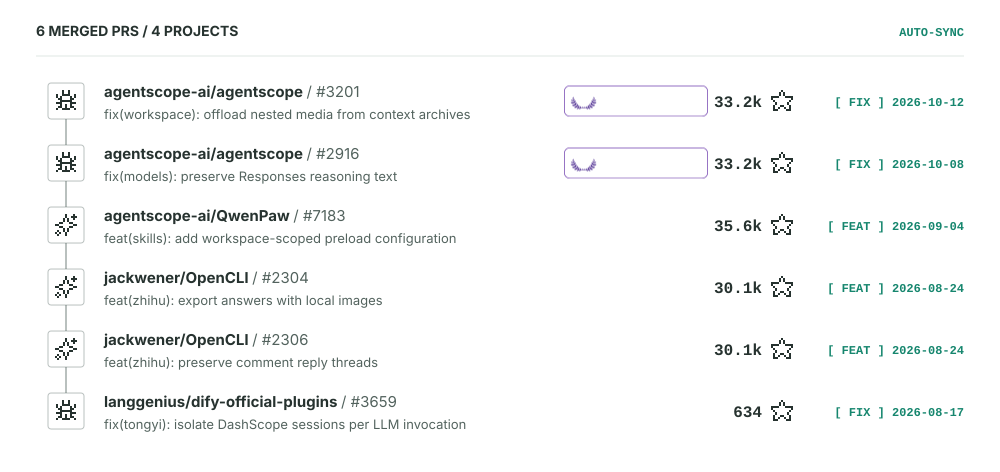

## 开源任务日志

<!-- OPEN_SOURCE_PRS:START -->
<picture>
  <source media="(prefers-color-scheme: dark)" srcset="./assets/contributions-dark.svg">
  
</picture>

[查看全部已合并的 Pull Requests →](https://github.com/pulls?q=is%3Apr+is%3Amerged+is%3Apublic+author%3Awuyak+-user%3Awuyak)

逐条打开 PR

- [agentscope-ai/agentscope #3201 · fix&#40;workspace&#41;: offload nested media from context archives](https://github.com/agentscope-ai/agentscope/pull/3201)
- [agentscope-ai/agentscope #2916 · fix&#40;models&#41;: preserve Responses reasoning text](https://github.com/agentscope-ai/agentscope/pull/2916)
- [agentscope-ai/QwenPaw #7183 · feat&#40;skills&#41;: add workspace-scoped preload configuration](https://github.com/agentscope-ai/QwenPaw/pull/7183)
- [jackwener/OpenCLI #2304 · feat&#40;zhihu&#41;: export answers with local images](https://github.com/jackwener/OpenCLI/pull/2304)
- [jackwener/OpenCLI #2306 · feat&#40;zhihu&#41;: preserve comment reply threads](https://github.com/jackwener/OpenCLI/pull/2306)
- [langgenius/dify-official-plugins #3659 · fix&#40;tongyi&#41;: isolate DashScope sessions per LLM invocation](https://github.com/langgenius/dify-official-plugins/pull/3659)

<!-- OPEN_SOURCE_PRS:END -->

<picture>
  <source media="(prefers-color-scheme: dark)" srcset="./assets/pacman-dark.svg">
  <source media="(prefers-color-scheme: light)" srcset="./assets/pacman-light.svg">
  
</picture>

<!-- Contribution animation: https://github.com/abozanona/pacman-contribution-graph -->
